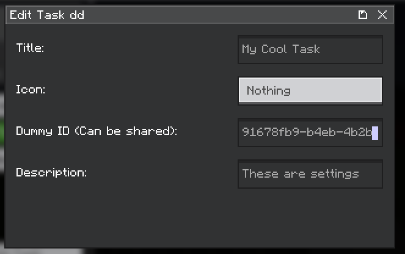
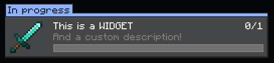

# Using the Library

Assuming you've [added Iolaus into your `build.gradle`](../index.md#using-iolaus){ data-preview } already, you can start using the library in your mod.

Before you begin, it's important to understand there are several moving parts when working with Heracles, that Iolaus helps to manage, and in some cases abstract away.

The whole process essentially boils down to:

1. Defining Tasks and/or Rewards
2. Feeding Input Data to Tasks, then handling progress
3. How to display widgets to the client in the Viewer
4. How to display & (de)serialize settings to the Client in the Editor
5. Registering Tasks & Rewards with Heracles
6. Registering Widgets & Settings with Heracles on the client

## Defining Tasks

For Tasks, Iolaus provides a [`BaseQuestTask`](https://github.com/hudsonm62/Iolaus/blob/master/common/src/main/kotlin/com/ziroau/iolaus/api/tasks/BaseQuestTask.kt) as a ready to go foundation for creating your own.
The [`CountedQuestTask`](https://github.com/hudsonm62/Iolaus/blob/master/common/src/main/kotlin/com/ziroau/iolaus/api/tasks/CountedQuestTask.kt) is an implementation of `BaseQuestTask` that handles
all the NBT storage boilerplate for tracking progress of how many times `X` needs to be done to complete the task as a whole, and is what you'll likely use for _most_ tasks in your mod.

You'll also need to write [`QuestTaskType`](https://github.com/terrarium-earth/Heracles/blob/1.21.1/common/src/main/java/earth/terrarium/heracles/api/tasks/QuestTaskType.java)
boilerplate code for serialization of your properties with Heracles.

```kotlin
package your.cool.mod.tasks

import com.mojang.serialization.Codec
import com.mojang.serialization.codecs.RecordCodecBuilder
import com.ziroau.iolaus.api.data.QuestElementDisplay
import com.ziroau.iolaus.api.registry.QuestTypesFactory
import com.ziroau.iolaus.api.tasks.CountedQuestTask
import com.ziroau.iolaus.samples.data.MyCoolInputData
import earth.terrarium.heracles.api.tasks.QuestTaskType
import net.minecraft.util.Identifier

class MyCoolTask(
    override val taskId: String,
    override val display: QuestElementDisplay,
    val someConfigProperty: String,
    override val amount: Int = 1 // required times to complete the task
) : CountedQuestTask<MyCoolInputData, MyCoolTask> {
    // Implement your matching logic here
    override fun matches(input: MyCoolInputData): Boolean {
        // everytime `input` matches the criteria for this task, return true
        return input.someProperty == someConfigProperty
    }

    // Necessary `QuestTaskType` Boilerplate below
    override fun type(): QuestTaskType<MyCoolTask> = TYPE
    companion object {
        @JvmField
        val TYPE: QuestTaskType<MyCoolTask> =
            QuestTypesFactory.task(
                Identifier.of("samplemod", "mycooltask_id")
            ) { id ->
                RecordCodecBuilder.mapCodec { instance ->
                    instance.group(
                        RecordCodecBuilder.point<MyCoolTask, String>(id),

                        QuestElementDisplay.CODEC
                            .forGetter(MyCoolTask::display),

                        Codec.STRING
                            .optionalFieldOf("someConfigProperty", "")
                            .forGetter(MyCoolTask::someConfigProperty),

                        Codec.INT
                            .optionalFieldOf("amount", 1)
                            .forGetter(MyCoolTask::amount)

                    ).apply(instance, ::MyCoolTask)
                }
            }
    }
}
```

!!! note

    See implementation of [`CountedQuestTask`](https://github.com/hudsonm62/Iolaus/blob/master/common/src/main/kotlin/com/ziroau/iolaus/api/tasks/CountedQuestTask.kt)
    if you want to understand how to handle storage & progress tracking, for overriding the `test` method for custom logic.

There are of course other tasks you could implement/extend - I would recommend looking at the source code for
[Iolaus](https://github.com/hudsonm62/Iolaus) & [Heracles](https://github.com/terrarium-earth/Heracles) to see what other tasks are available, and how they are implemented.

### Feeding Input Data to Tasks

You'll need to provide your own mechanism for feeding input data into your tasks so that the `matches` method (and ultimately, the `test` method) can evaluate it and progress the task accordingly.

Typically, you might want to "subscribe" to an event or some kind of data source that provides the input data relevant to your task:

```kotlin
package your.cool.mod.events

import earth.terrarium.heracles.common.handlers.progress.QuestProgressHandler
import net.minecraft.server.network.ServerPlayerEntity

object MyCoolEventListener {
    fun registerEventListener() {
        // Example: Subscribe to an event that provides MyCoolInputData
        SomeEvent.subscribe { input: MyCoolInputData ->
            // Feed the input data into your task system
            val sourcePlayer: ServerPlayerEntity = input.sourcePlayer

            // Hand off to the server thread for processing
            sourcePlayer.server.execute {
                val questProgress = QuestProgressHandler.getProgress(
                    sourcePlayer.server, sourcePlayer.uuid
                )

                // Let [MyCoolTask] handle the rest
                questProgress.testAndProgressTaskType(
                    sourcePlayer,
                    input,
                    MyCoolTask.TYPE
                )
            }
        }
    }
}
```

## Defining Rewards

Whilst similar to [Tasks](#defining-tasks), rewards are a bit simpler to implement - You can define a class that extends the Iolaus [`BaseQuestReward`](https://github.com/hudsonm62/Iolaus/blob/master/common/src/main/kotlin/com/ziroau/iolaus/api/rewards/BaseQuestReward.kt),
then provide the necessary properties.

For rewards, override the `reward` method to define the behaviour when the reward is granted. Similar to tasks, we also need to provide the necessary
[`QuestRewardType`](https://github.com/terrarium-earth/Heracles/blob/1.21.1/common/src/main/java/earth/terrarium/heracles/api/rewards/QuestRewardType.java) boilerplate for serialization.

```kotlin
package your.cool.mod.rewards

import com.mojang.serialization.Codec
import com.mojang.serialization.codecs.RecordCodecBuilder
import com.ziroau.iolaus.api.data.QuestElementDisplay
import com.ziroau.iolaus.api.registry.QuestTypesFactory
import com.ziroau.iolaus.api.rewards.BaseQuestReward
import earth.terrarium.heracles.api.rewards.QuestRewardType
import net.minecraft.item.ItemStack
import net.minecraft.server.network.ServerPlayerEntity
import net.minecraft.util.Identifier
import java.util.stream.Stream

class MyCoolReward(
    override val rewardId: String,
    override val display: QuestElementDisplay,
    val someConfigProperty: String
) : BaseQuestReward<MyCoolReward> {
    // `reward()` defines the behaviour when the reward is granted
    override fun reward(player: ServerPlayerEntity): Stream<ItemStack?> {
        println("Reward '$rewardId' with value '$someConfigProperty' has been granted :)")

        // Heracles expects a stream, despite the reward not necessarily producing items
        return Stream.empty()
    }

    // Necessary `QuestRewardType` Boilerplate
    override fun type(): QuestRewardType<MyCoolReward> = TYPE
    companion object {
        @JvmField
        val TYPE: QuestRewardType<MyCoolReward> =
            QuestTypesFactory.reward(
                Identifier.of("samplemod", "mycoolreward_id")
            ) { id ->
                RecordCodecBuilder.mapCodec { instance ->
                    instance.group(
                        RecordCodecBuilder.point<MyCoolReward, String>(id),

                        QuestElementDisplay.CODEC
                            .forGetter(MyCoolReward::display),

                        Codec.STRING
                            .optionalFieldOf("someConfigProperty", "")
                            .forGetter(MyCoolReward::someConfigProperty)

                    ).apply(instance, ::MyCoolReward)
                }
            }
    }
}
```

## Widgets & Settings

This is what is displayed on the client in the Quest Editor & Viewer.

### Defining Settings

**Settings** lets you edit the actual config properties for your task & rewards in the in-game editor.
It's then serialized into JSON in the Heracles quest files.



In order to define your settings, you can use the [`AbstractSettingInitializer`](https://github.com/hudsonm62/Iolaus/blob/master/common/src/main/kotlin/com/ziroau/iolaus/api/client/settings/AbstractSettingInitializer.kt) class provided by Iolaus.

!!! note

    Some methods from `AbstractSettingInitializer` are purely optional & for convenience, such as `textSetting()` or `intSetting()`,
    and don't actually do anything special on their own.

We then override 2x `create()` methods, one is to "put" settings, and the other is to "get" settings and provide default values if necessary (i.e. for missing or malformed JSON properties).

```kotlin
package com.example.mymod.client.settings

class MyCoolTaskSettings private constructor() : AbstractSettingInitializer<MyCoolTask>() {
    companion object {
        @JvmField
        val INSTANCE = MyCoolTaskSettings()
    }
    override fun create(task: MyCoolTask?): SettingInitializer.CreationData {
        val settings = SettingInitializer.CreationData()
        settings.put("someConfigProperty", textSetting(), task?.someConfigProperty ?: "")
        settings.putDisplaySettings(task)
        settings.put("amount", intSetting(), task?.amount ?: 1)
        return settings
    }
    override fun create(
        id: String, task: MyCoolTask?, data: SettingInitializer.Data
    ): MyCoolTask {
        val result = MyCoolTask(
            id,
            data.get("someConfigProperty", textSetting()).orElse(task?.someConfigProperty ?: ""),
            data.getDisplaySettings(task),
            data.get("amount", intSetting()).orElse(task?.amount ?: 1)
        )
        return result
    }
}
```

### Defining Widgets

**Widgets** represent the visual components for your task or reward in the viewer. They're responsible for rendering the task/reward title, description, icon, etc.
Widgets can use task/reward properties to dynamically render content based on the current state or configuration.



Depending on if you're extending a Task or Reward, there are several [abstract classes](https://github.com/hudsonm62/Iolaus/blob/master/common/src/main/kotlin/com/ziroau/iolaus/api/client/widgets) provided by Iolaus for creating widgets.

Let's create a widget class for our `MyCoolTask`, which uses `AbstractProgressTaskWidget` which includes a builtin progress bar:

```kotlin
package com.example.mymod.client.widgets

import com.ziroau.iolaus.api.client.widgets.AbstractProgressTaskWidget
import com.example.mymod.MyCoolTask

class MyCoolTaskWidget (
    override val task: MyCoolTask,
    override val progress: TaskProgress<AbstractNbtNumber>
) : AbstractProgressTaskWidget<MyCoolInputData, AbstractNbtNumber, MyCoolTask>() {
    // this uses the overridden icon automatically if defined
    override val widgetItemIcon: QuestIcon<*>
    get() = task.icon()

    // Here we can define the title & description, if the overridden values are not provided by the settings
    //// This lets us define cool dynamic texts based on the element's current state or configuration too if you so desire
    override val widgetTitle: Text
        get() = task.titleOr(
            Text.translatable("mydefault.title.translation.key")
        )

    override val widgetDescription: Text
        get() = task.descriptionOr(
            Text.translatable("mydefault.description.translation.key")
        )
}
```

Or for `MyCoolReward`, you would extend `AbstractRewardWidget` instead as this class provides a button and correct layout for claiming the reward.

```kotlin
package com.example.mymod.client.widgets

import com.ziroau.iolaus.api.client.widgets.AbstractRewardWidget
import com.example.mymod.MyCoolReward

class MyCoolRewardWidget private constructor(
    override val reward: MyCoolReward,
    override val questId: String,
    override val progress: QuestProgress?,
    override val interactive: Boolean
) : AbstractRewardWidget() {
    companion object {
        @JvmStatic
        fun of(reward: MyCoolReward, interactive: Boolean): MyCoolRewardWidget {
            val (questId, progress) = getQuestContext()
            return MyCoolRewardWidget(
                reward, questId, progress, interactive
            )
        }
    }

    override val widgetItemIcon: QuestIcon<*>
        get() = reward.icon()

    override val widgetTitle: Text
        get() = reward.titleOr(
            Text.translatable("mydefault.title.translation.key")
        )

    override val widgetDescription: Text
        get() = reward.descriptionOr(
            Text.translatable("mydefault.description.translation.key")
        )
}
```

## Registering Everything

Of course, you'll need to actually register your tasks, rewards, widgets & settings for them to be recognized and used within Heracles.

Iolaus provides some functions you can run from your initialization code to quickly achieve this:

**From Common Initializer:**

```kotlin
import com.ziroau.iolaus.api.registry.TasksRegistry
import com.ziroau.iolaus.api.registry.RewardsRegistry

object MyCoolModInitializer : ModInitializer {
    override fun onInitialize() {
        TasksRegistry.registerAll(
            MyCoolTask.TYPE,
            AnotherSickTask.TYPE
        )
        RewardsRegistry.registerAll(
            MyCoolReward.TYPE,
            AnotherSickReward.TYPE
        )
    }
}
```

**From Client Initializer:**

!!! warning

    DO NOT register widgets and settings from the common initializer, as they are client-side only!

```kotlin
import com.ziroau.iolaus.api.client.registry.TasksClientRegistry
import com.ziroau.iolaus.api.client.registry.RewardsClientRegistry

object MyCoolModClientInitializer : ClientModInitializer {
    override fun onInitializeClient() {
        TasksClientRegistry.register(
            MyCoolTask.TYPE,
            MyCoolTaskSettings.INSTANCE,
            ::MyCoolTaskWidget
        ) { progress, task ->
            val progress = task.storage().readInt(progress.progress()).coerceAtLeast(0)
            "$progress/${task.amount.coerceAtLeast(1)}"
        }
        TasksClientRegistry.register(
            AnotherSickTask.TYPE,
            AnotherSickTaskSettings.INSTANCE,
            ::AnotherSickTaskWidget
        ) { progress, task ->
            val progress = task.storage().readInt(progress.progress()).coerceAtLeast(0)
            "$progress/${task.amount.coerceAtLeast(1)}"
        }

        RewardsClientRegistry.register(
            MyCoolReward.TYPE,
            MyCoolRewardSettings.INSTANCE,
            MyCoolRewardWidget::of
        )
        RewardsClientRegistry.register(
            AnotherSickReward.TYPE,
            AnotherSickRewardSettings.INSTANCE,
            AnotherSickRewardWidget::of
        )
    }
}
```

You may have noticed in the client task registration that we provide a lambda to format the progress display.
Without this lambda, the client would not know how to format and ultimately present the task's progress to the user.

Of course, you can customize this lambda to display the progress in any way that makes sense for your task, however the format
used in the example would be suitable for all tasks that have a simple progress out of a total amount.
